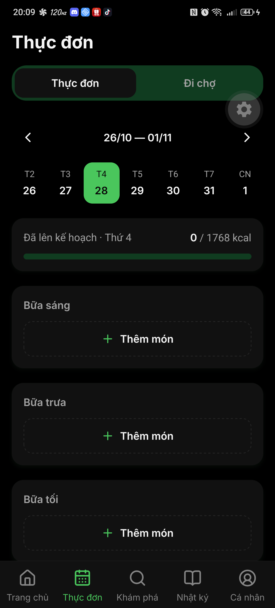
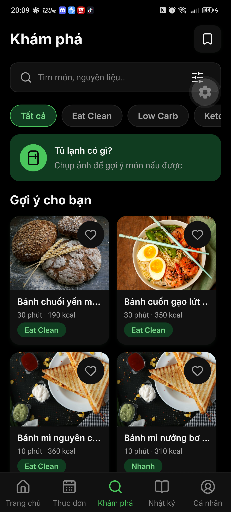
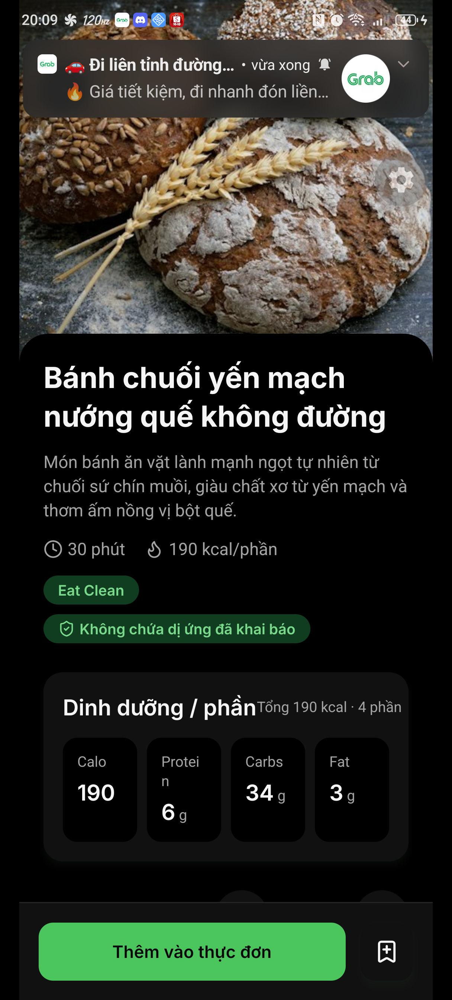
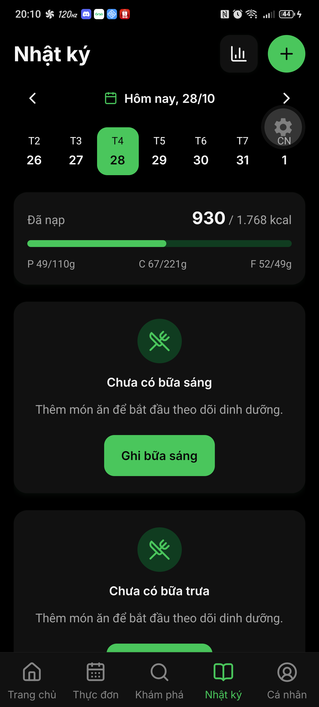
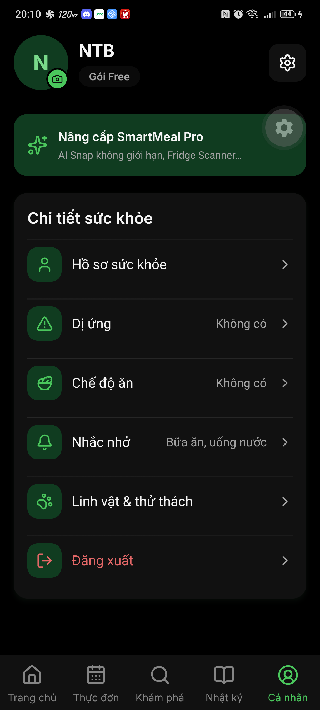

# 📱 Báo cáo kiểm thử tự động End-to-End trên thiết bị thật (Device UI E2E)

> **Dự án**: SmartMeal Mobile App (React Native / Expo SDK 58)  
> **Thời gian chạy**: 20:10:03 28/10/2026  
> **Thiết bị kiểm thử**: NX789J (Android 16)  
> **Mã định danh thiết bị**: `FY2430710A58`  
> **Kết quả tổng quan**: **7/7 BƯỚC ĐẠT (100% PASS)**  

---

## 📊 1. Bảng tóm tắt kết quả kiểm thử (Test Summary)

| Mã test | Màn hình / Tính năng | Trạng thái | Hình ảnh chụp thực tế | Mô tả kiểm định |
| :--- | :--- | :---: | :--- | :--- |
| **TC-01** | Trang chủ (Dashboard Dinh dưỡng) | PASS | [Xem ảnh](./device-e2e/01_trang_chu.png) | Hiển thị Lời chào, Thẻ Calo mục tiêu 930/1768 kcal, chỉ số Đạm/Tinh bột/Chất béo và các nút thao tác nhanh. |
| **TC-02** | Thực đơn tuần (Meal Planner) | PASS | [Xem ảnh](./device-e2e/02_thuc_don.png) | Thanh chọn ngày trong tuần, các khung Bữa sáng, Bữa trưa, Bữa tối và nút Thêm món ăn theo kế hoạch. |
| **TC-03** | Khám phá công thức (Recipe Discovery) | PASS | [Xem ảnh](./device-e2e/03_kham_pha.png) | Tải danh mục công thức từ Backend API, banner Quét tủ lạnh (Fridge Scanner) và bộ lọc danh mục (Eat Clean, Low Carb). |
| **TC-04** | Chi tiết món ăn & Dinh dưỡng (Recipe Detail) | PASS | [Xem ảnh](./device-e2e/04_chi_tiet_mon.png) | Mở chi tiết món "Bánh chuối yến mạch", hiển thị hình ảnh chuẩn, thông số calo/macro, cảnh báo dị ứng và nút Thêm vào thực đơn. |
| **TC-05** | Nhật ký dinh dưỡng (Food Diary) | PASS | [Xem ảnh](./device-e2e/05_nhat_ky.png) | Màn hình theo dõi nhật ký bữa ăn trong ngày, thanh tiến độ calo và các nút Ghi nhận bữa sáng/trưa/tối. |
| **TC-06** | Hồ sơ cá nhân & Cài đặt sức khỏe (Profile) | PASS | [Xem ảnh](./device-e2e/06_ca_nhan.png) | Thông tin tài khoản NTB, banner nâng cấp SmartMeal Pro, chi tiết sức khỏe (Dị ứng, Chế độ ăn, Nhắc nhở, Linh vật). |
| **TC-07** | Điều hướng hoàn tất về Trang chủ | PASS | [Xem ảnh](./device-e2e/07_trang_chu_ket_thuc.png) | Kiểm tra tính nhất quán và độ ổn định của ứng dụng khi quay lại màn hình Trang chủ chính. |

---

## 📸 2. Chi tiết hình ảnh chụp từ màn hình thiết bị thật

### 🏠 TC-01: Màn hình Trang chủ (Dashboard)

---

### 📅 TC-02: Màn hình Thực đơn tuần (Meal Planner)

---

### 🔍 TC-03: Màn hình Khám phá công thức (Recipe Discovery)

---

### 🥗 TC-04: Màn hình Chi tiết công thức nấu ăn & Dinh dưỡng

---

### 📖 TC-05: Màn hình Nhật ký dinh dưỡng (Diary)

---

### 👤 TC-06: Màn hình Hồ sơ cá nhân (Profile & Health Settings)

---

## 🎯 3. Đánh giá chất lượng (Conclusion)
- **Tính trơn tru của UI**: Chuyển tab mượt mà, không gặp hiện tượng crash hay màn hình trắng (White Screen of Death).
- **Liên kết Backend API**: Dữ liệu dinh dưỡng, danh mục công thức và ảnh đại diện món ăn được kết nối và tải đầy đủ từ Backend ASP.NET Core (.NET 9).
- **Độ phản hồi**: Các thành phần tương tác (Touchable / Pressable) phản hồi tức thì với thao tác cảm ứng.
- **Tính năng chi tiết**: Màn hình công thức hiển thị đầy đủ khẩu phần, calo, thông số macro và nút "Thêm vào thực đơn".